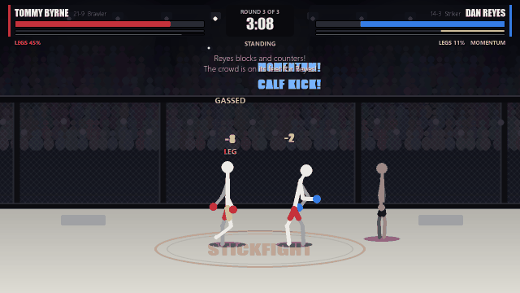

# USC: Ultimate Stickfight Championship

A turn based MMA game with stick figures. Both fighters pick a move in secret, then
both moves play out at the same time. Read your opponent, manage your stamina, and win
by knockout, submission or on the scorecards.



## Download

Get it from the [latest release](https://github.com/Vavoss123/stickfight/releases/latest).
Nothing to install.

- **Windows:** `Stickfight.exe`. Windows may say "Windows protected your PC" because the
  exe isn't signed. Click **More info**, then **Run anyway**.
- **macOS:** `Stickfight-macOS.zip` (Apple silicon). Unzip it, then right-click
  Stickfight and choose **Open** the first time, because the app isn't signed.
- **Linux:** `Stickfight-linux.tar.gz`. Unpack it and run `./Stickfight`.

The game checks for updates when it starts. When a new version is out, the menu says so
and pressing **U** downloads it and restarts the game (on Windows; macOS and Linux open
the download page).

## Running from source

```
pip install -r requirements.txt
python main.py
```

Needs Python 3.10 or newer. Works on Windows, Mac and Linux.

## Modes

- **Tutorial**. New players get a prompt on the menu (press T), and it is also under
  How to play. A coach walks you through a first fight in five short lessons.
- **Quick fight** against the computer on easy, normal or hard.
- **Local 2 player** on one keyboard. Red uses Q W E R A S D F Z, blue uses U I O P J K L ; M
  Picks stay hidden until both players have locked in.
- **Career**. Create a fighter, beat two prospects to get ranked, climb the top 10,
  win the belt and defend it. Wins earn training points to spend on your stats.
  Your career is saved in `~/.stickfight/career.json`.
  - A **rival** calls you out once you are ranked (or whoever beats you becomes one).
    Every few fights they demand a grudge match, which pays a bonus and can jump you
    up the rankings. Beat them twice to settle it.
  - Before a title fight you pick a **training camp** that adds 1 to a stat for that fight.
  - **Coach Ray** talks you through the big moments: your first fight, first win and
    loss, getting ranked, your rival, your first title shot, the belt.
  - **Judo throws** for wrestlers: Osoto Gari, Seoi Nage, Tomoe Nage, Uchi Mata and the Hip Toss, plus a
    Judo Black Belt perk. Career wrestlers start with Osoto Gari.
  - The **gym** is free, one session between fights. Coach Ray picks a drill at random:
    pad work, catching balls with the mouse, mitt work, a bell drill or combos. A good
    session earns a deck point. The bigger your deck budget (rank plus bonus points),
    the harder the drills.
  - **Trophies** on the hub shows your achievements and the secret fighters.
  - **Retire** to put your career in the **hall of fame**. A world title or a big enough
    legacy score gets you inducted.
- **Tournament**. Pick any fighter and win an eight fighter bracket in one night:
  quarterfinal, semifinal and final, three rounds each. About half the damage you take
  carries into your next fight, and cuts stay open.

- **Challenges**. A daily challenge with the same fight and the same twist for everyone
  that day (start the fight cut, face a heavyweight, finishes only, and more), with your
  best score and a streak. Eighteen achievements, and four secret fighters to unlock.

### Weight classes

Every fighter is a lightweight (155 lbs), welterweight (170), middleweight (185) or
heavyweight (240). Heavier classes hit harder and knock people out more often but gas
sooner, lighter classes are quicker and last longer. In quick fight and 2 player you can
match up any two fighters: the bigger one hits harder, takes shots better and wins more
scrambles, so a heavyweight beats a lightweight about three times in four. Career and
tournaments keep everyone at your weight.

### Controllers

Plug in any controller. In a fight A, B, X and Y pick moves 1 to 4 and the d-pad picks
5 to 8, so picks stay hidden. In 2 player one controller plays blue while red stays on
the keyboard, and two controllers play a corner each. Start pauses. In menus the d-pad or
stick moves, A selects and B goes back.

## How fights work

Every move is a Strike, a Grapple, a Submission or a Defend.

- Strike beats Grapple, you catch them coming in.
- Grapple beats Defend, they are standing still.
- Defend beats Strike, you block and counter.

On the feet there are a few twists. A jab is fast and beats a power punch to the punch.
A takedown walks through jabs, body shots and kicks but gets stopped by a power punch.
Clinching smothers a power punch. A leg kick goes under a block, a head kick does not.

Strikes hit the head, body or legs. Head shots do the damage. Body shots drain stamina
and slow its recovery, and enough of them can fold a fighter. Leg kicks take away power
and wrestling, and a fighter past 60% leg damage starts limping.

The fight moves between standing, the clinch, guard, mount and back control. Each
position has its own moves. Covering up stops strikes from the top, but it is not the
only way out: in guard a sweep or get up can scramble out through the punches, under
the mount a shrimp beats punches and a bridge beats elbows, and from the bottom of back
control you can turn in while they punch. A submission starts a contest with no dice: each turn the holder
picks Squeeze, Adjust angle or Ease off and the defender picks Explode, Hand fight or
Breathe. A squeeze beats an explosion or a breather, a hand fight stops a squeeze, and
an angle set by Adjust lets the next squeeze through. Gas and grappling skill decide the
close ones. The rear naked choke from the back is the most
dangerous of them, and escaping it still leaves you with them on your back.

Stamina is scarce. Every move costs it, the break between rounds only gives some back,
and a tired fighter hits softer, misses more and gets taken down and submitted. A move
you do not have the stamina for still comes out, but slow and weak (it shows as GASSED).

Elbows and big shots can open cuts. Blood in the eyes hurts accuracy, and a bad enough
cut gets the fight stopped by the doctor. Between rounds your corner reads the fight
and tells you what your opponent keeps doing, what they are reading from you, and how
the round went.

**Changing cards between rounds.** The coach looks at the round and suggests cards you
own: they kept shooting, put in Sprawl; you are gassed, put in Iron Lungs. Click an idea
to swap it in, or press **C** (blue presses **N** in 2 player) to open the deck. Two
changes a break, for that fight only. The computer's corner makes its own changes too.

**Scouting.** Before a career fight, **Scout** on the hub shows the opponent's style,
personality and cards, what to expect, and which of your cards the coach would bring.
Quick fight and tournaments show what to expect from the opponent as well.

Knockouts get a slow motion replay.

**Defence and counters.** Block and counter is a high guard for punches and head kicks,
but blocking heavy shots hurts your arms, and hurt arms leak damage through the guard,
punch softer and give up armbars. A **check kick** lifts the shin against leg kicks and
hurts the kicker's leg more than their kick would have hurt you. A **weave** costs
stamina and either slips the strike clean or walks into it for 1.5 times the damage. A
**knee** is the answer to a takedown and hits twice as hard on someone shooting in,
while a jab never stops one.

**Limbs.** Full health is not safe. Body damage at 100% cracks the ribs and leg damage at
100% breaks the leg: either ends the fight as a TKO.

**What you are going after.** The moves are laid out by target, HEAD, BODY, LEGS, ARMS
and NECK, and hovering one lights up the spot on your opponent. The armbar goes after
the arms, from guard or from mount.

**Feints and follow ups.** A feint is cheap and beats a block: they freeze, get no rest,
and you get a read that makes your next strike faster and more accurate. Feint into a
strike or a takedown and you are the one caught. Landing clean gives you a follow up:
your next strike comes a little faster. So after you land, do they block the follow up,
or eat the feint?

**The referee.** About one strike in a hundred is a foul (an eye poke, a low blow, a shot
to the back of the head), more when someone is exhausted. The first is a warning, then
it costs a point on every scorecard. The referee also breaks up a clinch that goes
nowhere and stands up a ground fight where nothing is happening.

**Momentum.** Landing shots, knockdowns, takedowns, reversals and submission attempts fill
a fighter's hype meter (the purple bar under stamina). When it is full the crowd is on
its feet and the next attack goes **all in**: more accurate, harder hitting, harder to
stop. Covering up three times in a row without blocking anything gets you booed and
drains it.

**Personalities.** Every computer fighter has a way they like to fight: pressure fighters
keep coming, counter punchers wait behind the guard, grinders hold you down, showboats go
for the highlight reel. They talk in character too: in the walkout, when they land or
get hurt, when either of you tires, on takedowns and submissions, and before the last
round.

## Fight cards

Every fighter has a deck. Signature cards are named after the techniques fighters made
famous (Superman Punch, Showtime Kick, Calf Kick, Imanari Roll, D'Arce, Peruvian Necktie,
Twister, Gogoplata and more). Each one takes the slot of a basic move and changes how it
works, usually with a trade-off. Some swap in a different kind of move, so a grappler can
trade strikes for Guard Pull, Single Leg or a Flying Triangle. Perk cards change how you fight: Never Say Die,
Combination Puncher, Dutch Kickboxing, Iron Lungs, Granite Chin and others.

In career mode fights pay purse money, wins give a pack to pick one card from, and the
shop restocks after every fight. A duplicate levels a card up to a maximum of 5. Cards
cost 1 to 3 deck points depending on how strong they tested (shown on each card), and
the budget grows as you climb the rankings. The shop and packs mark which cards are
already in your deck.

Stats run from 1 to 10 through training. Hover a stat on the hub to see what each point
does. Perks and training camp can take a stat past 10, up to 12, so a perk on a maxed
stat still counts.

Money and spare points have uses once your fighter is built: the shop sells extra
training points, extra deck points (up to 6), a restock and glove colours, and on the
hub you can trade 5 training points for a deck point or 3 for a card pack. Training
camp before a title fight can take a stat to 11 for that fight, or you can do film study
to start the fight with a read on them.

In quick fight, 2 player and tournaments, press **Edit deck** on the select screen. The
deck has a 10 point budget and is remembered for that fighter. The button at the top
switches between every card unlocked and **your collection**: every card you have earned
in any career, kept even after you retire (`~/.stickfight/collection.json`).

## Settings

Volume, crowd noise, fullscreen (or F11), fight speed and skipping the walkouts are in
**Settings** on the main menu and the pause menu. They save to `~/.stickfight/settings.json`.

## Feedback

Press **F1** on any screen to write a quick note. Notes go to `~/.stickfight/feedback.txt`
along with the fight situation (round, position, health, stamina and the last few moves).

Fights are 3 rounds of 8 exchanges (title fights are 5 rounds). Three judges score each
round on damage, takedowns, control time, submission attempts and knockdowns.

## Project layout

```
engine/      game rules, no pygame (fighters, moves, resolving exchanges, AI, career)
ui/          pygame drawing: stick figures, poses, the arena, screens
tools/       balance simulator
tests/       engine tests
```

All move numbers live in `engine/moves.py` and the fighter styles in `engine/roster.py`.

## Balancing

The simulator plays thousands of AI vs AI fights and reports win rates by style, how
fights end, and how often each move is picked and works:

```
python -m tools.simulate --fights 100 --level hard
```

The card tester puts one card on a fighter and plays mirror matches against the same
fighter without it, to find cards that are too strong or too weak:

```
python -m tools.cardsim --fights 1000
```

## Making the README GIF

```
python -m tools.make_gif --out docs/ko.gif
```

Plays AI against AI fights until one ends in a knockout and saves the end of it with
the replay. Needs Pillow (`pip install pillow`).

## Tests

```
python -m unittest discover tests
```

## Releasing a new version

Push a version tag and GitHub builds the exe and publishes the release:

```
git tag v0.2.0
git push origin v0.2.0
```

The version number comes from the tag, and players on older versions get the update
prompt the next time they start the game. The workflow builds Windows, macOS and Linux.

To also publish to itch.io, make the game page there, add a repository secret called
`BUTLER_API_KEY` (itch.io, Settings, API keys) and check `ITCH_GAME` at the top of
`.github/workflows/release.yml`. The text for the page is in `docs/itch.md`.

## License

MIT, see [LICENSE](LICENSE).
