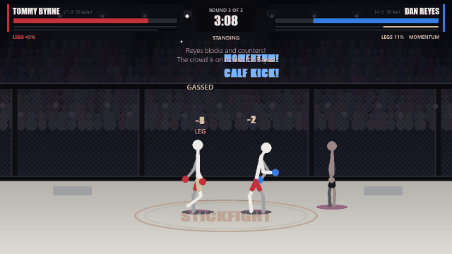

# USC: Ultimate Stickfight Championship

Turn based MMA with stick figures. You and your opponent both pick a move in secret,
then they happen at the same time. It's mostly about reading the other person: do they
keep shooting for takedowns, do they cover up when they're hurt, are they about to gas?



## Download

Grab the latest build from [releases](https://github.com/Vavoss123/stickfight/releases/latest).
No installer.

- **Windows**: run `Stickfight.exe`. It isn't signed, so Windows will warn you. Click
  More info, then Run anyway.
- **Mac** (Apple silicon): unzip `Stickfight-macOS.zip`, then right-click the app and
  pick Open the first time.
- **Linux**: unpack `Stickfight-linux.tar.gz` and run `./Stickfight`.

The game checks for updates on start. On Windows press U on the menu to update in place;
on Mac and Linux it opens the download page.

## What's in it

- A tutorial (press T on the menu) that gets you through a first fight in a couple of minutes
- Quick fight against the computer, and 2 player on one keyboard with hidden picks
- A career: make a fighter, pick a look and a personality, work up from prospect fights
  to the title. There's a rival, a gym between fights, training camps, injuries and
  hospital bills when you lose, and a hall of fame when you retire
- Eight man tournaments in one night where the damage carries over
- A daily challenge, achievements and a few secret fighters
- Cards: signature moves (Superman Punch, Uchi Mata, Imanari Roll, Twister...) and perks
  you build a deck from
- Four weight classes, controller support, and slow motion replays of knockouts

Your career fighter also shows up in quick fight and 2 player. The Code button on the
career screen gives you a code for them, so a friend can paste it in (Add fighter by code)
and fight you with that fighter on their computer.

## Playing

Every move is a strike, a grapple, a submission or a defend. Strikes beat grapples,
grapples beat defence, defence beats strikes, and then there are a lot of exceptions:
a jab beats a power punch to the punch, a knee stops a takedown, a check kick punishes
leg kicks, a feint freezes someone waiting to block. The fight moves between standing,
the clinch, guard, mount and back control, and each position has its own moves.

Submissions are a little game of their own. The one holding it squeezes, adjusts the
angle or eases off; the one stuck in it explodes, hand fights or breathes. No dice, so
it comes down to the read, how much gas you have left and who the better grappler is.

How to play in the game covers all of this with pictures, and the words that pop up in a
fight (ROCKED, CAUGHT, CHECKED and so on) get explained the first couple of times you see
them.

Controls:

| | |
|---|---|
| Pick a move | number keys or click (red uses Q W E R A S D F Z X C V and blue U I O P J K L ; M , . / in 2 player) |
| Pause | Esc |
| Mute | M (F10 in 2 player, where M is a move) |
| Fullscreen | F11 |
| Write a feedback note | F1 |

Saves live in `~/.stickfight/`. Notes from F1 go to `~/.stickfight/feedback.txt` with the
fight situation attached, which makes them a lot easier to act on.

## Running from source

Python 3.10 or newer:

```
pip install -r requirements.txt
python main.py
```

The code is split into `engine/` (the rules, no pygame) and `ui/` (everything you see).
Move numbers are in `engine/moves.py`, cards in `engine/cards.py`, the fighters in
`engine/roster.py`.

Tests:

```
python -m unittest discover tests
```

## Balance

I keep the styles close to even with a simulator that plays the computer against itself:

```
python -m tools.simulate --fights 100 --level hard
python -m tools.cardsim --fights 1000      # one card against a mirror match without it
```

Notes from past runs are at the bottom of `TODO.md`.

## Releases

Pushing a version tag builds Windows, Mac and Linux and publishes a release, and players
get the update prompt next time they open the game:

```
git tag v0.6.0
git push origin v0.6.0
```

For itch.io, add a `BUTLER_API_KEY` secret and check `ITCH_GAME` in
`.github/workflows/release.yml`. The store page text is in `docs/itch.md`.

The GIF at the top comes from `python -m tools.make_gif --out docs/ko.gif` (needs Pillow).

## License

MIT, see [LICENSE](LICENSE).
